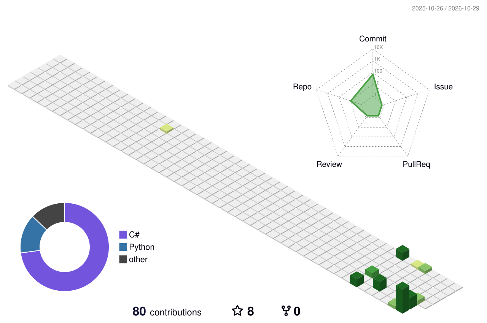

    

<!--   my-icons -->

    
    
    
    
    
    
    

<!--   my-ticker -->

  

---

<!--   my-skils -->

| Property                                        | Data                                                                                                                                                                                                                                                                                                                                                                                                                                                                                                                                                                                                                                                       |
|-------------------------------------------------|------------------------------------------------------------------------------------------------------------------------------------------------------------------------------------------------------------------------------------------------------------------------------------------------------------------------------------------------------------------------------------------------------------------------------------------------------------------------------------------------------------------------------------------------------------------------------------------------------------------------------------------------------------|
| **Language / IDE**                              |     &nbsp; |
| **Domain Knowledge**                            |    |
| **CI / CD**                                     |  &nbsp;   |
| **Game / Engine**                               |     |

---

## Highlight projects

| Project | Description | Stack |
|---|---|---|
| [SnakeGameWpf](https://github.com/MEIMAOA/SnakeGame) | Snake 5 modes + Arknights-style 3D Tower Defense (10 levels, skills, multi-language) | C# · Unity/Tuanjie · IMGUI |
| [SnakeLauncherWPF](https://github.com/MEIMAOA/SnakeLauncherWPF) | Game launcher with GitHub release sync, auto-update, Win11 acrylic UI | C# · .NET 10 · WPF |
| [Snake-Game-Python-Edition-](https://github.com/MEIMAOA/Snake-Game-Python-Edition-) | Multi-mode Snake engine (Classic / 100 AI Battle Royale / 4v4 / Extraction) with HMAC anti-cheat + Named Pipe IPC | Python · Pygame · IPC |
| [ShutdownTimer](https://github.com/MEIMAOA/ShutdownTimer) | Simple and reliable shutdown timer | C# |

---

<!--   GitHub stats graph -->
### GitHub Activity Graph

<!--   stats + languages -->
| . | . |
|---|---|
|  |  |

  

<!--   green snake -->

<!-- dark snake -->

<!--   profile-green-animate -->

<!--   2023 contributions snake (2023 is complete, so this is a static snapshot) -->
### 2023 Contributions

1,151 contributions · 199 active days

  <picture>
    <source media="(prefers-color-scheme: dark)" srcset="./assets/snake-2023-dark.svg" />
    <source media="(prefers-color-scheme: light)" srcset="./assets/snake-2023.svg" />
    
  </picture>

---

  
Trophy: GitHub Profile Trophy

  

---

**How to Reach me:**

  
  
  

#### Thanks for visiting

  
   
  counting of visitors to this page
    
  

## Star History

[MIT](LICENSE)

---

*If you liked my profile, you can Star  the repo and if you want to use this template you can Fork it and can use.*

---

Would you like to meet me?

If you want to contribute to any of my repositories, feel free to submit PRs, issues or email me. Make sure to describe the agenda first.

